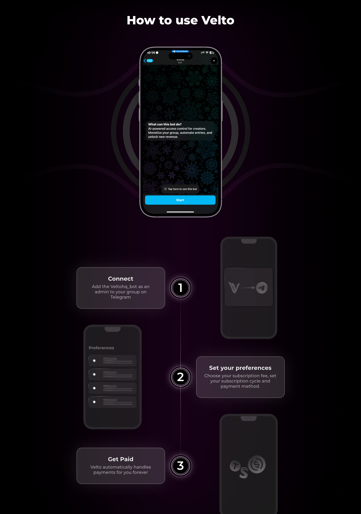
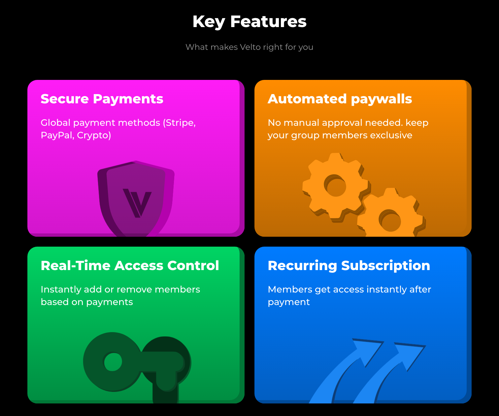
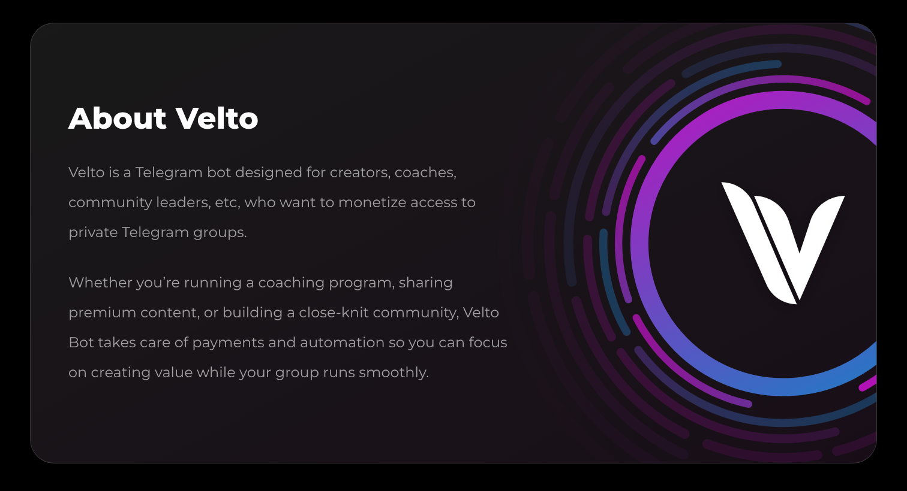

# Velto

A landing page for a Telegram paywall bot. I designed it in Figma in 4 days, then directed an AI coding tool to build it into a working, animated, responsive demo in a single session.

## At a glance

- **Role:** Product and UI designer. I owned the research synthesis, the Figma design and the art direction of the build.
- **Team:** Solo on the page. The original product idea and creator research were shared with colleagues.
- **Timeline:** 4 days of design, then one build session.
- **Tools:** Figma for design, Claude Code (an AI coding tool) for the build in React and Tailwind CSS.
- **Outcome:** A working desktop and mobile demo that explains a product that was never built, with no real screenshots to lean on.

## The problem

Creators who sell access to private Telegram groups run their paywall by hand. They collect payments, track who has paid, and add and remove members themselves, while still posting content every day. My colleagues and I spoke to ~30+ creators, mostly running crypto groups, and their most consistent complaint was how tedious it is to keep track of subscriptions manually. Some of us had seen the same problem firsthand.

## Goals & constraints

- **Explain the product in seconds.** A visitor should know what Velto does before they scroll.
- **Earn trust.** The page asks people to route money through a bot, so it has to look safe enough to pay through.
- **No real product screenshots.** The product was never built, so nothing real could be shown.
- **Solo, self-directed project.** No brand team, no developer, no outside deadline.

## Approach

I designed the full page in Figma: a 1512px desktop layout, a 430px mobile layout and the mobile menu. The structure is short on purpose: a hero, payment methods, a three-step how-it-works, an About section, four key features, a call to action and a FAQ.

Three decisions shaped it:

- **Mockups and illustrations instead of screenshots.** With no product to show, phone mockups carry the "how it works" story. Each feature gets a single bold illustration (a shield, gears, a key, arrows) rather than a fake interface that would invite scrutiny.
- **Payments up front to build trust.** The first section after the hero names the payment providers: Stripe, PayPal, Paystack and stablecoins. Recognisable brands do the trust work faster than any copy could.
- **Card *and* crypto payments.** Most of the creators we interviewed ran crypto groups, so crypto had to sit alongside card payments. Leaving it out would have excluded the core audience.

I then directed Claude Code to build the page from the Figma file. My role in the build was the one a design lead plays with an engineer: I set the brief, reviewed each pass against the design and called out what was wrong. The AI wrote the code.

Motion was a decision I made during the build. The first version matched the design but felt flat, so I asked for an animation per feature that acts out what the feature does. The key slides into a lock and turns (access control), the gears mesh (automation), the arrows rise (recurring revenue) and the shield lifts into place (security). The rings around the logo in About slowly orbit, and the nav button has a spinning gradient glow. Every animation switches off for visitors who have turned on their device's reduce-motion setting.

## Challenges

**Reviewing a build I didn't write.** The page looked right at first glance, but it had gaps that only showed up in use. The About section was assembled incorrectly, the mobile menu's close button didn't respond, and the navbar scrolled away instead of staying fixed. I found these by clicking through the built page on desktop and mobile and comparing it with my Figma frames, then described each issue precisely enough that it could be fixed in one pass.

**Motion with no spec.** Because I hadn't designed the animations up front, each one was decided in conversation. That worked, but it meant iterating live (for example, the keyhole's unlock glow took two attempts before it read clearly against the card) instead of handing over a defined motion spec.

## Results

- **4 days** from blank file to a complete desktop and mobile design; **1 session** from design to a working build.
- **2 layouts** (desktop and mobile) that follow the Figma file closely, plus a working mobile menu.
- **7 custom animations**, all drawn in code rather than as image files, which also cut ~290 KB of images from the page.
- The product itself was never launched, so there is no usage or conversion data. This is a portfolio demo.

## What I learned

- **Prototype the motion and interactions before handoff.** A clickable Figma prototype would have settled the animations before the build and exposed the mobile menu and fixed-navbar behaviour as design decisions, not bugs found afterwards.
- **Directing an AI build is a design review skill.** The quality of the result depended on how precisely I could say what was wrong: which element, which screen size, what it should do instead.
- **Without a product to show, illustrate the benefit, not the interface.** Bold single-idea illustrations explained the features faster than mock screens would have, and they gave the motion something to act out.

## Links

Demo available on request.
